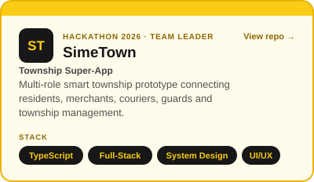
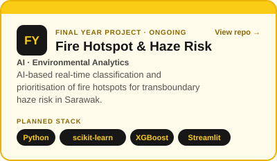
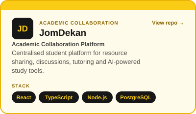
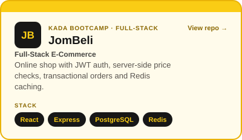
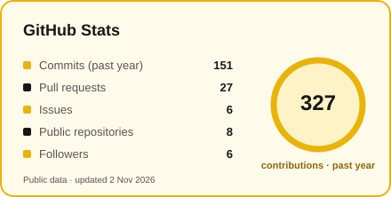

**🎓 Third-Year BSc (Hons.) Computer Science · Universiti Teknologi MARA (UiTM)**

## ✨ About me

I'm a Computer Science student working towards a career as a **Business & Data Analyst**. I understand systems end to end: I can **gather requirements, model the data, analyse it, and build the application** that puts the insight in front of people.

---

## 🚀 Featured projects

### 🏙️ SimeTown — Township Super-App

**Team Leader · Sime Darby Property University Hackathon 2026**

<!-- TODO: add your result, e.g. "Finalist (top X of Y teams)" -->

A multi-role township prototype connecting residents, merchants, couriers, guards and management, with role-based dashboards, incident tracking, smart parcel lockers, flood alerts and sustainability rewards. I led the team, aligned the technical design and UX with the challenge brief, and contributed to development and the pitch.

**Stack:** TypeScript · Full-Stack · System Design · UI/UX
🔗 [Repository](https://github.com/nurinirdnz/SimeTown) · 🌐 [Live demo](https://simetown.onrender.com/)

Independent student prototype, not an official Sime Darby Property product. Demo data is simulated.

### 🔥 Final Year Project — AI Fire Hotspot & Haze Risk _(ongoing)_

Combines NASA FIRMS satellite fire detections with weather and air-quality data to classify persistent vs short-lived hotspots, predict next-day haze, and rank hotspots by transboundary haze risk for Sarawak, delivered through a monitoring dashboard for decision-makers.

<!-- TODO: add real progress, e.g. "Baseline XGBoost model: X% accuracy on N hotspots" -->

**Stack:** Python · pandas · scikit-learn · XGBoost · Streamlit · Folium
🔗 [Repository](https://github.com/nurinirdnz/Final-Year-Project)

### 🎓 JomDekan — Academic Collaboration Platform

One place for students to share resources, discuss, find tutors and use AI study tools, replacing scattered group chats and drives.

<!-- TODO: add a concrete detail, e.g. number of testers or the database schema you designed -->

**Stack:** React · TypeScript · Node.js · Express · PostgreSQL · OpenAI API · Docker
🔗 [Repository](https://github.com/nurinirdnz/Jom-Dekan)

### 🛒 JomBeli — Full-Stack E-Commerce

Built during the **KADA AI-Enabled Full Stack Bootcamp**. Orders and their items are saved in a single PostgreSQL transaction with a price snapshot, so order history stays accurate when products change. Also includes JWT auth, server-side price checks and Redis caching.

**Stack:** React · Zustand · Tailwind CSS · Node.js · Express · PostgreSQL · Redis
🔗 [Repository](https://github.com/nurinirdnz/Jom-Beli)

**Other work:** [CI/CD & automated testing lab](https://github.com/nurinirdnz/CSC640-week4-lab) (GitHub Actions) · CNN animal image classifier (TensorFlow, Streamlit) · clinical management system (PHP, Oracle SQL)

---

## 🧰 Tech toolbox

**Also:** SQL · Oracle SQL · SPSS · Requirements & system analysis · UML & ERD · REST APIs · Agile/Scrum · Automated testing

---

  

🐟 My koi is drawn nightly from my GitHub activity with <a href="https://github.com/yalongwastaken/git-koi">git-koi</a>.

  

**Always happy to talk data, analytics or projects. Let's connect on [LinkedIn](https://www.linkedin.com/in/nurinirdinaz/).**

