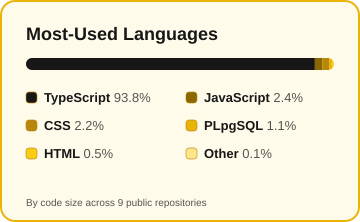
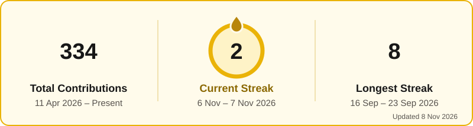
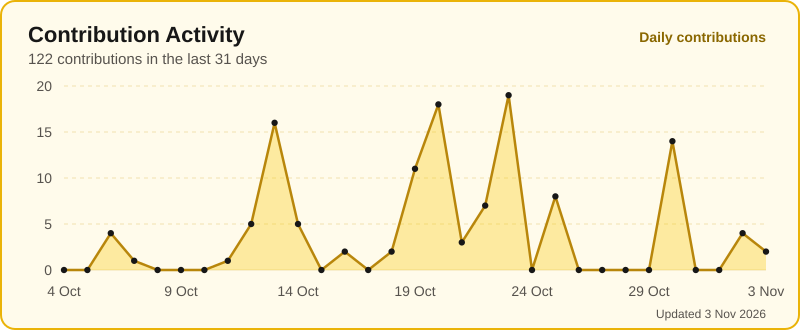

<strong>🎓 Third-Year Bachelor of Computer Science (Hons.) · Universiti Teknologi MARA (UiTM)</strong>

---

## ✨ About me

I'm a **Computer Science student at UiTM** working towards a career as a **Business & Data Analyst**. What sets me apart is that I understand systems end to end: I can **gather requirements, model the data, analyse it, and build the application** that puts the insight in front of people.

My interests span **business and system analysis, data analytics, AI/ML, and full-stack software engineering**. I love designing systems that help people make better decisions and simplify everyday workflows.

<table><tr><td width="50%" valign="top">

### 🎯 What I'm focused on

- 📊 Business, data & system analysis
- 🗄️ SQL, database design & data visualization
- 🤖 AI, machine learning & computer vision
- 💻 Full-stack applications & REST APIs

</td><td width="50%" valign="top">

### 🌱 What I'm building

- 🔥 **FYP:** AI-based fire hotspot classification and transboundary haze risk prioritisation in Sarawak
- 🏙️ **SimeTown:** A multi-role smart township prototype
- 🔄 Better engineering workflows with CI/CD, automated testing and Git

</td></tr></table>

---

## 🧰 Tech toolbox

**Languages & data**

**Web development**

**AI, development & infrastructure**

 

     

<strong>🔎 Explore my full skill set (click to expand)</strong>

| Area | Skills |
|---|---|
| 📊 Data & analytics | SQL, MySQL, Oracle SQL, Python, SPSS, data analysis, visualization, database design |
| 📋 Business & systems | Requirements analysis, system analysis, UML, ERD, database modelling, technical documentation |
| 💻 Programming | Python, Java, C++, JavaScript, TypeScript, PHP |
| 🌐 Full-stack | React, Node.js, Express.js, REST APIs, Tailwind CSS, HTML, CSS |
| 🤖 AI & ML | TensorFlow, Keras, CNN, computer vision, machine learning, LLM API integration |
| ⚙️ Platforms & tools | Git, GitHub, GitHub Actions, Docker, PostgreSQL, Redis, SQLite, Oracle Database, Streamlit |
| 🔄 Practices | Agile, Scrum, CI/CD, automated testing, version control, pull requests, code review |

---

## 🚀 Featured projects

### 🏙️ SimeTown — Township Super-App

**Team Leader · Sime Darby Property University Hackathon 2026**

A student-built, multi-role township prototype for the **Township of Tomorrow — People & Planet** challenge, connecting residents, merchants, couriers, guards and township management.

📊 **Analyst angle:** Designed around five stakeholder groups, with role-based dashboards, incident tracking and reporting for township operations.

🔗 [Repository](https://github.com/nurinirdnz/SimeTown) · 🌐 [Live demo](https://simetown.onrender.com/)

<strong>🟡 Explore SimeTown's features and my contributions</strong>

- 🏡 **Resident services:** Community events, neighbourhood assistance, reports, visitor passes, parcels and service bookings.
- ♻️ **Sustainability:** Recycling, walking routes, merchant offers and points/XP rewards.
- 🛟 **Safety & accessibility:** Flood alerts, Simple Mode, read-aloud support and emergency assistance workflows.
- 📦 **Smart parcels:** Locker simulation, courier verification, one-time codes and guardhouse operations.
- 📈 **Operations:** Role-based dashboards, staff workflows, incident tracking and reporting.
- 🤖 **AI assistance:** Resident information lookup and selected confirmed actions.
- 👩‍💻 **My role:** Led the team, helped align technical design and UX with the challenge, and contributed to development and presentation.

**Focus:** Team leadership · Full-stack · System design · UI/UX · Sustainability

> Independent student prototype, not an official Sime Darby Property product. Demo data and integrations are simulated.

### 🔥 Final Year Project — AI Fire Hotspot & Haze Risk

**AI-Based Real-Time Classification and Prioritisation of Fire Hotspots for Transboundary Haze Risk in Sarawak** · *Ongoing*

A proposed AI and environmental analytics system combining satellite fire detections, weather and air-quality observations to support proactive haze risk monitoring.

📊 **Analyst angle:** Integrates satellite, weather and air-quality datasets into predictive models and a monitoring dashboard for decision-makers.

🔗 [Repository](https://github.com/nurinirdnz/Final-Year-Project)

<strong>🟡 Explore proposed objectives and technology</strong>

- Classify fire hotspots into persistent fires and short-lived detections.
- Predict next-day haze conditions using machine learning.
- Prioritise hotspots by potential transboundary haze impact.
- Develop a near-real-time interactive monitoring dashboard.
- Support environmental monitoring and decision-making.

**Planned tools:** Python · pandas · NumPy · scikit-learn · XGBoost · Streamlit · Folium · NASA FIRMS · Himawari-9

### 🎓 JomDekan — Academic Collaboration Platform

A centralised student platform for academic resource sharing, discussions, tutoring and AI-powered study tools.

📊 **Analyst angle:** Brings scattered study resources, discussions and tutoring into one platform backed by a PostgreSQL database.

🔗 [Repository](https://github.com/nurinirdnz/Jom-Dekan)

**Stack:** React · TypeScript · Node.js · Express · PostgreSQL · OpenAI API · Docker

### 🛒 JomBeli — Full-Stack E-Commerce

Built during the **KADA AI-Enabled Full Stack Bootcamp**. Includes search/filtering, shopping cart, JWT authentication, order history, server-side price verification, transactions and Redis caching.

📊 **Analyst angle:** Orders and their items are saved in a single PostgreSQL transaction with a snapshot of each price, so order history stays accurate even when products change.

🔗 [Repository](https://github.com/nurinirdnz/Jom-Beli)

**Stack:** React · Zustand · Tailwind CSS · Node.js · Express · PostgreSQL · Supabase · Redis · JWT

<strong>📁 More projects — click to explore</strong>

 

| Project | What it does | Stack | Code |
|---|---|---|---|
| 🔄 **CSC640 — Git, Testing & CI/CD Lab** | Git branching, pull requests, Python automated testing, GitHub Actions CI and GitHub Pages deployment | Python · GitHub Actions · GitHub Pages | [Repository](https://github.com/nurinirdnz/CSC640-week4-lab) |
| 🏃 **FitWUs — AI Fitness & Wellness** | Fitness, nutrition, hydration and wellness routines, with analytics and an AI assistant | React · Node.js · Express · MySQL · LLM integration | Not public |
| 🐾 **Animal Image Classification** | CNN-based animal image classifier with a Streamlit upload and prediction interface | Python · TensorFlow · Keras · Streamlit | Not public |
| 🏥 **Clinical Management System** | Database-driven application for structured clinical and patient information workflows | PHP · Oracle Database · SQL | Not public |
| 🛍️ **PreYourLoveds!** | Pre-loved e-commerce application built with Java MVC architecture | Java · JSP · Servlets · MySQL | Not public |

---

## 📊 GitHub dashboard

Generated from the GitHub API and refreshed every 24 hours by <a href="./.github/workflows/update-dashboard.yml">GitHub Actions</a>.

---

## 📚 Currently learning

<strong>🌟 See what I'm exploring next</strong>

- **Business & data analytics:** Turning business problems into measurable insights.
- **AI & ML:** Developing and evaluating machine-learning models.
- **Data engineering:** Preparing, processing and integrating datasets.
- **Software engineering:** Improving quality through testing and structured workflows.
- **DevOps:** CI/CD, Docker, deployment and GitHub Actions.
- **Human-centred design:** Accessible, intuitive digital experiences.

## 🌐 Explore more

The portfolio is on a free host and may take a few seconds to wake up.

**Let's connect, collaborate and build something meaningful.**

### 💛 Building solutions through data, technology and continuous learning.

